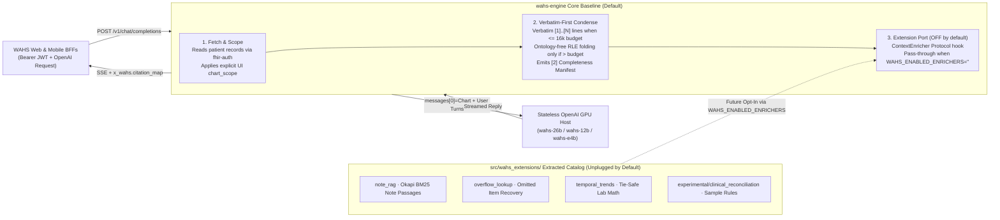

# `wahs-engine`

Minimal, zero-privilege OpenAI-compatible FHIR R4 condensation and citation middleware for **Washington Health Summary (WAHS)**.

## Architecture (3-Step Baseline + Unplugged Extension Shelf)

## Package Layout

- `src/wahs_core/`: Pure-Python stdlib (`python -S` verified, zero third-party deps):
  - `extractors.py`: Domain-neutral FHIR R4 parser (`ClinicalItem`, `ClinicalNote`, `NumericPoint`).
  - `condenser.py`: 3-Tier Verbatim-First Monotonic Condenser (`Tier 0` Verbatim -> `Tier 1` Ontology-Free RLE -> `Tier 2` Budget-Packed).
  - `chart_serializer.py`: `[1]..[N]` chart renderer + citation traceability mappings.
  - `ports.py`: Hexagonal `ContextEnricher` `Protocol` + `EnrichmentDisclosure` schemas.
- `src/wahs_engine/`: Slim FastAPI runtime (`app.py`, `assembler.py`, `upstream.py`, `pipeline.py`, `config.py`, `schemas.py`, `jwt_claims.py`, `tokenizers_registry.py`).
- `src/wahs_extensions/`: Unplugged R&D enricher catalog ([README](src/wahs_extensions/README.md)), OFF by default (`WAHS_ENABLED_ENRICHERS=""`).
- `src/wahs_devtools/`: Synthetic HAPI/Keycloak demo persona seeder (`wahs-seed-hapi`).

## Wire Contract (`/v1/models`, `/v1/chat/completions`, `/v1/wahs/context/preview`)

- **Clean Model IDs:** `wahs-26b` (`ollama/gemma4:26b`, default), `wahs-12b` (`ollama/gemma4:12b`), `wahs-e4b` (`ollama/gemma4:e4b`).
- **Explicit Scoping (`wahs`):** `master_patient_id`, `chart_scope`, `overlay_resources`, `target_budget_tokens` (default ceiling `16,384`), `refresh`, `emit_stream_events`.
- **Non-Goals by Design:** Middleware privacy redaction/segmentation is intentionally unbuilt here pending UW CIRG selective-disclosure design; access isolation is enforced by `fhir-auth` and explicit UI `chart_scope` / `ips_bundle_id`.
